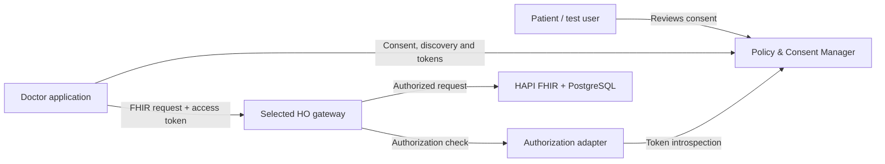

# HDP Reference Architecture

A runnable synthetic-data sandbox for consent-mediated health-data access.
It includes a Doctor application, Policy & Consent Manager (PCM), Consent and
Services interfaces, Admin and Logs, and three isolated health organizations
running HAPI FHIR/PostgreSQL behind authorization gateways.

Use it to see how **Health Data Portability (HDP)** works. In Doctor, request
access for a synthetic patient. In PCM, review the request and choose what to
share. Back in Doctor, fetch the approved records from each organization and
follow the request in Logs. You can also connect your own application or FHIR
source and exercise the same flow.

**Release 0.2.0.** The Linux/amd64 images are on GitHub Container Registry.
Use synthetic records for demonstrations and integration tests. The external
implementation guides define the official requirements. See the [release limitations](docs/releases/0.2.0.md)
for known vulnerabilities and the scope of the source-companion review.

[Get started](#get-started) · [Try the flow](#try-the-consent-and-data-access-flow) ·
[Datasets](docs/datasets.md) · [API references](#standards-and-api-references) ·
[Run tests](#run-tests)

## What you can explore

- **Consent from request to withdrawal.** Request access in Doctor, review and
  approve it in PCM, then see how consent status and expiry affect access.
- **Data across organizations.** Discover sources and retrieve authorized records
  from three isolated HAPI FHIR/PostgreSQL health organizations.
- **Services and permissions.** Browse and configure service definitions for uses
  such as laboratory results, medications and clinical summaries. Approved
  permissions determine which resources and actions a client can use.
- **FHIR queries.** Try searches, counts, paging and supported Patient operations.
  Doctor includes an optional FHIR GET path for testing a specific request.
  Sources enforce patient and grant restrictions on the results.
- **OAuth and SMART on FHIR.** Exercise signed client assertions, opaque access
  tokens, source-side introspection, SMART discovery and authorization-code
  flows with PKCE. Each source receives its own token and audience.
- **Organizations, endpoints and certificates.** Manage participant details,
  service registrations and source configuration through the sandbox interfaces.
- **Four operating profiles.** Start with simpler connectathon authentication or
  test mTLS and Strict behavior. Every profile enforces approved clinical
  permissions; relaxed authentication checks do not grant broader data access.
- **An inspectable request journey.** Follow requests through Doctor, PCM,
  gateways, adapters and HAPI in the central Logs interface. Built-in
  **Explain this page** help describes the controls on each screen.
- **Repeatable test environments.** Create isolated teams with fresh credentials,
  explicitly import synthetic datasets, and use the included unit, runtime and
  browser tests to exercise integrations.

Optional [HMO, dependent and SMART workflows](docs/hmo-test-journey.md) extend the
basic journey. The [Services guide](docs/service-templates.md) explains how to
customize requested access.

## How it fits together

PCM manages consent and authorization. The Doctor application acts as a service
provider: it obtains authority from PCM and requests records directly from the
selected health organization's protected FHIR endpoint.



Each of the three health organizations has its own gateway, authorization adapter,
HAPI server and database. Records remain at their source. The adapter checks PCM
authority and supplies internal authorization context; HAPI applies the clinical
permissions before returning data. Admin import and maintenance use separate
private credentials.

The legacy Node source remains available for labelled compatibility testing. It
does not serve ordinary clinical requests and is excluded from Strict. See the
[architecture](system-architecture.md) and
[data-source integration guide](pcm-connectathon/data-source-implementation-guide.md)
for component boundaries and supported behavior.

## Get started

### What you need

- **Linux amd64**, or an amd64 Linux distribution under **WSL2**. On WSL2, keep
  the checkout on its Linux filesystem.
- **Node 24.22.1** (see `.nvmrc`), npm, Git and OpenSSL.
- **Docker Engine and Docker Compose**, available inside the Linux environment.
- Enough memory and disk for three HAPI/PostgreSQL instances and image builds.
  An 8-CPU, 32-GiB host with at least 40 GiB free is a useful starting
  configuration, not a measured minimum.

Java 17+ is needed for host-side Java tests; container builds do not require host
Java. If accessing the sandbox from another machine, allow its printed listener
ports through the host firewall.

### Install the checkout

Both the prebuilt images and the source build use the team setup scripts in
this repository. Use the checkout containing this README.

```sh
git clone https://github.com/ronenabra/HDP-reference-architecture-v2-public.git
cd HDP-reference-architecture-v2-public
npm ci
```

### Start with the published images

The seven sandbox images on GitHub Container Registry use the tag
`0.2.0-rc.1-audit-20261117`. Compose runs six of them and uses pinned upstream
Node and PostgreSQL images. The seventh sandbox image is a standalone data
loader. Run this block from the repository root to pull the team images and
start a team from that exact build.

```sh
(
  set -eu
  prefix=ghcr.io/ronenabra/hdp-reference-architecture-v2-public
  tag=0.2.0-rc.1-audit-20261117
  for component in pcm-core sp-client ds-auth-adapter ds-fhir-server ds-gateway ho-fhir; do
    docker pull --platform linux/amd64 "$prefix-$component:$tag"
  done
  # Compose uses a local name for the HAPI image shared by the three sources.
  docker tag "$prefix-ho-fhir:$tag" "pcm-ho-fhir:$tag"
  docker pull --platform linux/amd64 postgres:17-alpine@sha256:742f40ea20b9ff2ff31db5458d127452988a2164df9e17441e191f3b72252193
  docker pull --platform linux/amd64 node:24.22.1-alpine3.24@sha256:06d7adf3e0ef61a13f1d28682726366f97a15aa1888c934d3ecec86c33918b53
  VERSION="$tag" PCM_HAPI_VERSION="$tag" node pcm-connectathon/scripts/bootstrap-local-team.js \
    --team-id public-demo --teams-root tmp/connectathon-teams --preset connectathon-balanced --no-build
)
```

The [image inventory and license companion](docs/releases/0.2.0.md#published-images)
lists the packages, digests and companion download command.

### Or build from source

Use a source build when you want to run changes from your checkout. Choose
one startup method for a new team.

```sh
node pcm-connectathon/scripts/bootstrap-local-team.js \
  --team-id public-demo --teams-root tmp/connectathon-teams --preset connectathon-balanced
```

### Open the applications

Bootstrap generates the team's credentials, runs startup sanity checks and
prints its Doctor and PCM addresses. Open those URLs. The ports can differ
between teams. Admin uses the password in the team's private `.env` file.

| Application | What to do there |
| --- | --- |
| **Doctor** | Select a patient and service, request consent, discover sources and fetch data. |
| **PCM / Consent** | Review consent requests and inspect their status and approved access. |
| **Services** | Browse and manage service definitions and their requested permissions. |
| **Admin** | Configure the team and sources, import data and inspect operations. |
| **Logs** | Follow requests across components and investigate errors. |

These instructions apply to this version. Root Compose alone is not the supported installation.
If you used the earlier four-service demo, read the [migration guide](docs/migration.md).

### Add synthetic data

Managed clinical databases start empty. Synthetic population datasets are distributed separately in
[HDP-synthetic-dataset](https://github.com/ronenabra/HDP-synthetic-dataset).
The [dataset guide](docs/datasets.md) provides verified download and import
instructions for the **1k and 10k populations**, release **4.2.2-2026-10-10**.
Start with 1k for a smaller import. The small fixtures in this repository support
tests only.

### Choose a profile

Choose `connectathon-balanced` for the introductory flow above. Other profiles
let you explore different authentication and transport settings:

| Profile | Use it to explore |
| --- | --- |
| `connectathon-easy` | Local flows with six configurable authentication/transport checks relaxed by default. |
| `connectathon-balanced` | Integration flows with a mix of TLS and assertion checks. |
| `connectathon-mtls` | Verified mTLS and assertion checks using local demo material. |
| `strict` | Fixed protocol checks without connectathon relaxation or the legacy source. |

See [profiles and permissions](docs/scope-enforcement.md) for the exact settings.
Strict is still a sandbox profile, not independent certification. The dataset's
sandbox GUID patient identities are intended for non-Strict connectathon use;
the [dataset guide](docs/datasets.md) explains the available test identities.

## Try the consent and data-access flow

1. Import a verified synthetic dataset through Admin **Sources & data**, or use
   the dataset guide's explicit import command when creating the team.
2. Open **Doctor**, select a patient identifier present in that dataset and
   choose a service describing the access you want to request.
3. Request consent. Open **PCM / Consent** to review and approve the request.
   Some test configurations can simulate approval; the interface labels that
   behavior rather than treating it as a patient's decision.
4. Return to **Doctor**, refresh the consent status and discover available sources.
5. Fetch data from a selected source. The returned records must satisfy the
   approved patient, resource and action restrictions.
6. Open **Logs** to inspect the request, authorization checks and source response.

Choosing a service does not itself grant permission. Doctor normally shows a
first page of up to ten results per type and source. Its optional **FHIR GET path**
can request a particular resource or query; it does not bypass authorization.
Doctor does not automatically follow all pages or redirects. An empty result,
a denied request and an unavailable source mean different things.

Use [the sandbox guide](docs/public-quickstart.md) for browser addresses, HTTPS,
SMART callbacks and troubleshooting. Sign-in, dependent lookup and HMO eligibility
need the configuration described in [optional workflows](docs/hmo-test-journey.md);
importing data alone does not enable them.

## Stop, restart and troubleshoot

```sh
# Stop while preserving data.
node pcm-connectathon/scripts/stop-local-team.js --team-id public-demo --teams-root tmp/connectathon-teams

# Restart the same team using the existing local images.
node pcm-connectathon/scripts/start-local-team.js --team-id public-demo --teams-root tmp/connectathon-teams --no-build
```

For deliberate disposal, the stop command's `--volumes` option deletes that team's
database volumes. Generated host files remain. See [operations](docs/public-quickstart.md)
and [migration and backups](docs/migration.md) before resetting or upgrading.

Start troubleshooting in **Logs**: filter by source, time or level and inspect
request details. An import timeout can occur after data was written; check the
operation status and use [import recovery](clinical-data/README.md) before retrying.

Generated credentials, teams, backups and logs must remain private. Logs deliberately
contain non-AWS tokens, cookies and synthetic FHIR data in every preset.
Authenticated full-history exports use private staging. HTTP 207 reports
partial source failures; HTTP 409 reports a concurrent clear during preparation.
An export failure is not a complete or empty history result. Browse limits do not
truncate the retained-history export. See [Logs and investigation](docs/logging-platform.md)
and the [Admin API](docs/openapi-admin.yaml).

## Standards and API references

The sandbox implements **PCM-IG 0.4.2**. The following publications provide the
canonical requirements and guidance:

- [PCM implementation guide and profiles](https://simplifier.net/pcm-il)
- [IL Core](https://simplifier.net/ilcore)
- [HDP profiles and guidance](https://simplifier.net/hdp-il)
- [PCM FHIR/OAuth OpenAPI](https://github.com/MohGovIL/Swagger)
- [FHIR IL legislation and certification resources](https://www.fhir-il-community.org/legislation)

The local [PCM API page](docs/api-docs.html) links to the external specifications.
The sandbox's private management operations have their own
[Admin OpenAPI definition](docs/openapi-admin.yaml) and
[rendered Admin reference](docs/admin-api-docs.html).
Canonical guides, profiles and public API payloads are not bundled here;
[external references](docs/external-references.md) explains the test-input downloads.

## Run tests

```sh
npm ci
npm run prepare:contracts
npm test
```

`prepare:contracts` downloads 66 public Swagger/Simplifier inputs, verifies pinned
hashes and caches them in ignored directories. It requires no private repository.
See [external inputs and offline setup](docs/external-references.md).

```sh
# Component, native Java, contract, schema, OpenAPI and Compose checks:
# requires a JDK 17+ on the host; the Maven wrapper supplies Maven.
npm run verify:fast

# Fast checks plus disposable runtime/browser tests across all four profiles.
# Requires Docker capacity; creates and removes its own test teams.
npm run verify:full -- --wait-timeout 600
```

The full verifier runs each required scenario in a fresh test environment.
Browser tools use a pinned Docker image. See [CONTRIBUTING](CONTRIBUTING.md) for
supplemental UI and optional Python checks. Full regression validation and follow-up fixes are planned for 0.2.1.

## Find your way around the code

| Directory | Purpose |
| --- | --- |
| [src/pcm-core](src/pcm-core) | Consent, authorization, participant management and the PCM interfaces. |
| [src/sp-client](src/sp-client) | Doctor application and service-provider flows. |
| [src/ds-gateway](src/ds-gateway) | NGINX gateway configuration. |
| [src/ds-auth-adapter](src/ds-auth-adapter) | PCM token validation and internal source authorization. |
| [src/ho-fhir-server](src/ho-fhir-server) | HAPI FHIR extensions and clinical permission enforcement. |
| [src/ds-fhir-server](src/ds-fhir-server) | Legacy Node compatibility source. |
| [clinical-data](clinical-data) | Import, verification, recovery and small test fixtures. |
| [pcm-connectathon](pcm-connectathon) | Team setup, operations and runtime/browser verification. |
| [scripts](scripts) | Build, documentation, contract-input and packaging tools. |

See [changes](CHANGELOG.md), the [Apache-2.0 license](LICENSE) and
[third-party notices](THIRD_PARTY_NOTICES.md). HAPI and other bundled software
retain their own notices and applicable distribution conditions.
